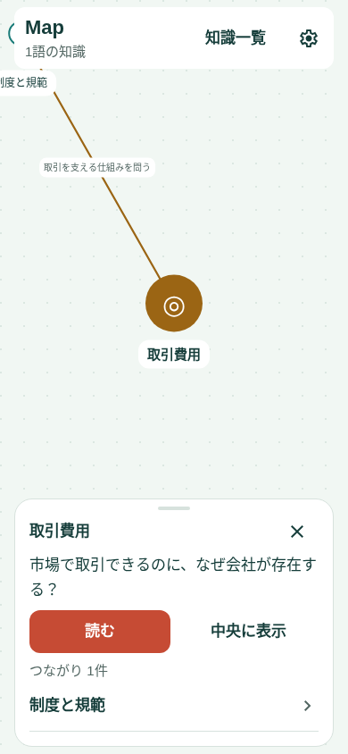
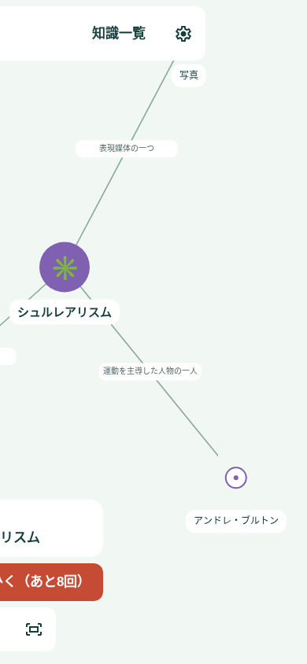
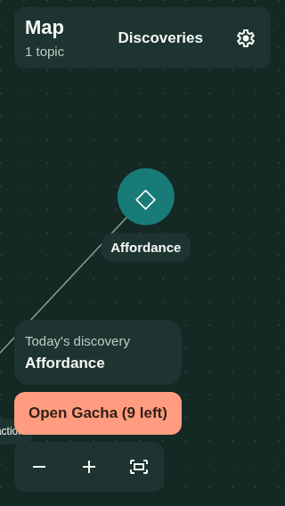

# 日次権利の繰越・Mapでの開封・通知初期値（2026-11-11）

状態: 実装・自動テスト・Web操作検証・iOS export済み、実機確認待ち。ユーザー指示によって、以前の「繰越なし」「開封直後に記事」「通知・バッジ初期オフ」を変更する。

## 体験

- Map左下に「今日の知識（当日の直近語、なければ最近の知識）」を読むボタンと、コーラル色の「ガチャをひく（あとN回）」を独立した面・間隔で表示する。残り0なら抽選ボタンを無効にする。全件取得済みも明示する。
- 保存成功後のキャラクター演出はMap内のシートで行い、終了/スキップ/閉じるでその知識へフォーカスし、一言説明のプレビューを表示。全文はプレビューの「読む」から記事へ進む。タブは増やさない。
- 記事末尾からの追加開封もMapの同じ演出/プレビューへ戻す。保存・連打制御・動きを減らす設定を維持する。

## 毎日の権利

現行v2は当日1回を繰り越さないため、ご希望の「3日分なら3回」に対応していない。v3では日次付与の開始日`startedOn`を保存し、開始日から当日までの暦日数−日次分の消費数を残高とする。初回特典の未消費残高を加算し、日次分を優先消費する。3日経過したら3回分増える（すでに1回分残っていれば合計4回）。教材未取得数は実際に引ける回数とバッジの上限とし、権利残高自体は失効させない。

初期10回（特典9＋初日1）は維持。最初の起動で開始日を永続化し、まだ開封せず閉じた場合も開始日を失わない。旧v1/v2は既存履歴・特典・開発日付を保持して移行し、最古の開封日から未消費の日次分を計算する。開封履歴のない既存データは移行日を開始日とする。保存に失敗した場合、移行・新規開始・開封を確定しない。

日数はローカル日付をUTCの暦日番号へ変換して計算し、夏時間の23/25時間を1日として扱う。日付を戻しても過去の取得を無効化しない。端末内の試作管理であり、時計変更を防ぐサーバー管理は今回の範囲外。

保存キーは維持するがv3になるため、v3を読めない旧コードへの単純ロールバックは不可。本文・Map・言語・通知設定は削除しない。

## 通知とバッジ

- 未設定の通知は初期オン・8:00、バッジも初期オン。保存済みのオフ・時刻は保持する。
- 起動時、進捗と言語・両設定が読めた後に、未許可なら標準のOS通知許可を一度要求する。OSの許可そのものをアプリ側でオンにはできない。拒否済みのOS設定を繰り返し要求せず、設定から変更できるようにする。初期化/旧データの読込失敗中には許可を要求しない。
- 日本語の通知タイトル「今日も、知らなかった世界へ」、本文「新しい言葉との出会いが待っています。ガチャをひらいてみませんか。」。英語も同じ意味にする。開封した当日は通知を休む。将来の開封予定や残り回数を本文で断定しない。
- 繰越によって将来のバッジ数が増えるため、従来の固定数・毎日繰り返し1件を撤去。翌日以降の0時へ、未取得教材数に達するまでの変更分だけ無音・本文なしの単発通知を最大30件予約する。上限に達した数はそのまま残せる。開封時に現在残高と将来予約を同期する。
- 音ありリマインダーは30日先までに短縮。最大30件のバッジ＋最大30件のリマインダー＋テスト1件＝61件でiOSの上限64件以内。旧60件のリマインダーを先に整理してから新しいバッジ予約を行い、移行時にも上限を超えないよう共有の直列キューを使う。
- バッジとリマインダーのオフは引き続き独立し、自分のIDだけを取り消す。日付切替の実際の配送時刻はOS依存で、前面復帰時には現地の保存済み残高へ同期する。

## 検証

3日・月またぎ・年またぎ・夏時間、同日の繰越分の連続消費、初期10、旧履歴の移行、最初の未開封状態の保存、再起動、保存失敗・過剰消費・全件取得を検証。通知/バッジの初期値と保存済みオフの保持、初回OS許可の一回性、予約数上限・移行・独立性を確認する。Mapの独立ボタン・保存後の演出・スキップ/閉じる・一言プレビュー・全文への移動を日英/小画面で検証。lint・型チェック・全ロジックテスト・Web・iOS exportを実施し、実機のOS許可・バッジ・戻る操作は別途確認する。

## 実装・検証結果

- v3の日次付与開始日を初回読込み時に保存し、開封前に閉じても付与が継続する。旧データは同じキーに保存し直し、履歴・初回特典・開発日付を保持する。破損データや保存失敗では確定しない。
- 日次分を同日に複数回消費できる。初期10回を消費した残高0から、3日分を貯めて3回引くテストに成功。月/年/閏日/夏時間、日付の後退、移行後の未使用分、過剰消費拒否も検証した。
- 左下の読み返しは白い面、抽選はコーラルの独立ボタン。開封後はMapで取得語と一言プレビューを表示し、「読む」で記事へ。記事末尾の追加開封も同じMap演出へ戻る。
- 演出省略時の連打が背後のMapへ届く問題を修正。開封開始から結果表示後350msまではCanvasの選択をブロックし、新しい語の結果を保持する。新しい開封の保存に失敗した場合はブロックを解除する。
- 英語320pxでMap見出しが分断されないようヘッダーに最小幅を設定し、一覧の英語名を短い「Discoveries」にした。
- 新しい通知設定はオン/8:00、バッジもオン。明示的な既存のオフや時刻をそのまま復元する。未許可なら読込み完了後にOSの許可を要求。デフォルトの要求と手動操作が重なってもOSへの要求は一つにまとめる。拒否済み・Web・設定オフ・進捗読込失敗では自動で要求しない。
- 通知は日英の文案を更新し、開封した日には通知しない。バッジは翌日以降の残高を最大30日先まで予約し、リマインダーも30日先まで。両サービスは同じ直列キューを使う。旧60件予約からの移行でも遠い予約を先に整理し、64件を超えずに旧固定バッジを置き換えるテストに成功。
- ロジックテストは83ケース。lint・型チェック成功。iOS Hermes export成功。Webの`daily-rollover-map.cjs`で開始日保存・開封保存失敗・初期10回のMap演出と結果・記事からの抽選・読み返しと抽選の分離・3日分の繰越と同日3回消費・再読み込み・通常の再読で再抽選しないことを確認した。
- Webの日本語390×844/英語暗色320×568、通常演出と動きを減らす設定を確認。設定の日英表示も成功。旧`map-first-discovery.cjs`/`map-home.cjs`/`gacha-ten.cjs`は今回の導線の試験へ移管した。
- 既存v2からの移行で、以前は失効していた日次分が残高へ復活する場合がある。実際の抽選数は未取得教材数で制限する。保存形式のv3対応なしに以前の更新へ戻さない。
- 新しいネイティブ依存・runtimeVersion変更はなく1.0.4の互換更新として扱える。実機のOS許可・8:00受信・背景での日次増加・バッジ更新・シートの触り心地は未確認。マージ・配信は未実施。

### プレビュー（Web）

