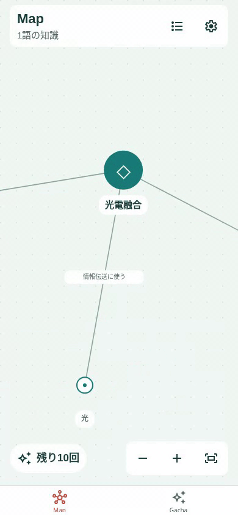

# ゆっくり泳ぐ知識のMap（2026-11-10）

## 実装前の設計

知識が生き物のようにゆっくり動き、個体ごとに速度や休む間合いが異なり、滑らかに方向転換するMapを実装する。通常倍率で元の位置の周囲およそ14〜24点、毎秒1〜2点程度の控えめな移動とする。ランダムな行き先への加減速と時折の休止で動きを作り、短い往復の反復にしない。

動的配置が持つ基準座標とは別に、描画用の小さな移動量を持つ。ノード・線・文字・当たり判定・中心へ寄せる操作は同じ描画座標を使う。配置の意味、Mapカメラ、取得履歴、権利、保存キーを変えない。移動量は保存せず、起動ごとに行き先を変え、IDごとの速度には個体差を持たせる。

## 読みやすさと操作

- 選択中の知識と直接つながる知識、または選択中の関係の両端は、その場で静止する。解除しても元の座標へ跳ね戻らず、滑らかに再開する。
- 指を置いた時点で全体の動きを止め、ドラッグ・ピンチ・カメラ移動の後は1秒以上待ってからゆっくり再開する。ドラッグ開始時の見た目の座標を引き継ぎ、離した際に移動量が二重に加わる位置ずれを防ぐ。
- 縮小すると画面上の動きも小さくなり、全体を俯瞰する倍率では止める。
- OSの「視差効果を減らす」設定が未確定または有効な場合は停止する。設定変更時も急に基準位置へ戻さない。
- 非表示タブ・別画面・シート表示中・アプリが背面にある間は停止する。復帰時に経過時間をまとめて進めない。

## 実装範囲と性能

既存のReanimatedで描画中のノードだけを毎秒約30回更新する。Reactの毎フレーム再描画や、常時のD3シミュレーション再加熱を追加しない。線は既存の3パスにまとめた描画を維持する。通常Mapと件数別デモで適用し、デモの計測中は新しい動きを止めて従来の操作計測に混ぜない。

## 受け入れ条件

移動範囲・速度・滑らかな転回・個体差、選択／タッチ／ピンチ／非表示／OS設定での停止、停止後の再開とドラッグ時の座標継続を確認する。NodeテストとWeb操作で線・ラベル・当たり判定の一致、Map位置と履歴の不変、500件デモの描画制限を確認する。lint・型チェック・iOS exportを行い、動画で動きをレビューできるようにする。実機の見え方・消費電力は別途確認する。

## 実装・検証記録

- 小さな移動量と速度・行き先・休止時間を持つ独立した状態を追加。IDごとの速度は0.85〜約2.1点/秒、移動範囲は14〜約24点。行き先を6〜16秒ごとに変え、時折1.8〜5.6秒休み、速度の補間で滑らかに曲がる。基準配置と保存データは変更しない。
- UI側のフレームコールバックで約30Hzに制限し、描画中のノードだけを更新。線・ラベル・当たり判定・フォーカスに共通の描画座標を渡す。非表示・背面・OSの動きを減らす設定ではコールバックを停止し、フレーム内にも停止条件を持つ。
- 選択中と直接の隣接ノードは移動量を保持して停止する。タッチ・ピンチ・カメラ移動後は1.2秒待ち、0.9秒かけて再開する。倍率0.35未満では新たな移動を止める。ドラッグ開始時に移動量を基準座標へ吸収し、離した後の二重加算を防ぐ。
- 初期配置・ドラッグ後のD3による配置収束は従来どおりで、このランダムな動きとは別に扱う。デモでは一覧・詳細シート・計測・計測結果の表示中もランダムな動きを止める。
- lint・型チェック・Nodeテスト9ファイル・iOS exportが成功。10分相当の移動範囲・速度・滑らかな転回・休止・個体差を自動検証。実際のフレーム処理を共有値モックで実行し、非表示・背景・タッチ・ピンチ・俯瞰で更新しないこと、選択近傍の静止、操作後の待ち時間と再開を確認。
- Webの通常モーションで、実際の移動と速度、線の追従、動くノードのタップと隣接ノードの静止、触れたままの停止・離してからの再開、OS設定の動的な切り替え、設定画面への移動と復帰、カメラ・履歴の不変を確認した。
- 動くノードを35×20点ドラッグし、見た目のつかんだ位置を引き継ぎ、離した瞬間の余分なずれがないことを確認。通常モーションでChromiumの二本指ピンチを実行し、最後の指を離した後もカメラがずれないことを確認。
- 5/10/50/100/500件デモの描画制限と3パス描画、通常Mapの開封・詳細・読書・カメラ復元も成功。非表示画面はナビゲーターがサイズを変えたり取り外したりするため、UI上の復帰確認とフレーム処理自体の停止テストを分けた。
- iPhone上での読みやすさ、タップ・ドラッグの感触、背景復帰と消費電力は未測定。Web動画は実機の性能検証ではない。既存のネイティブ依存だけを使うため、1.0.2のpreview更新として配信できる。

### Webプレビュー

通常速度の10秒間をGIFに変換したもの。倍速にはしていない。

