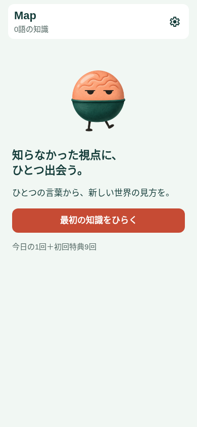
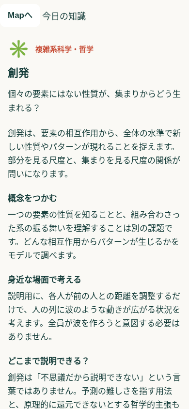
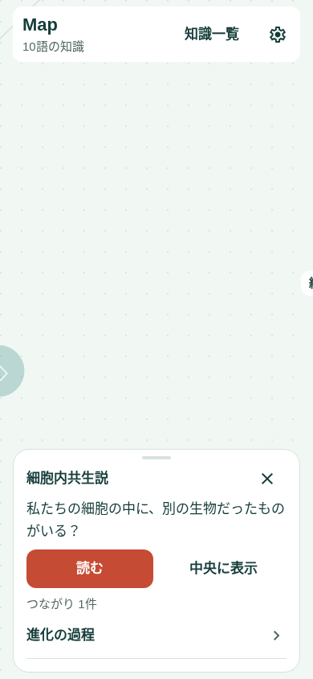
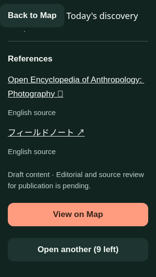

# Mapをホームに、開封から読書までを一続きにする

> 2026-11-11の追記: 日次権利の繰越、Mapでの開封結果、通知8:00・バッジの初期オンは[新しい設計](daily-rollover-map-reveal.md)を参照。この文書の当初の仕様と検証は履歴として保持する。


2026-11-10。状態: **実装・自動テスト・Web操作検証・iOS export済み、今回のUI変更の実機確認待ち**。最初の設計は現行コードと既存のWeb画像を確認して作成。下記に実装結果を追記。

## 目的

対象は、仕事の知識は必要に応じて調べる一方、専門外の概念に触れる機会が減った社会人。「他学部の授業で、知らなかった概念に出会った嬉しさ」を日々再現する。優先するのは、ひらく → 意外な視点を知る → 自分の知識との関係に気づく体験。

Mapを唯一のホームにする。開封はホームから始める行為、読書は一語に集中する画面、一覧は知っている語を探す画面とする。地図の操作を覚えなくても毎日の開封・読書が完結する。

## 前案と現行UIのレビュー

| 判断 | 根拠と改善 |
| --- | --- |
| Gachaタブの廃止には賛成 | Mapからも同じ抽選ができる。ユーザーが場所を選ぶ必要をなくす。ただしGachaに残る特典・履歴・検証用操作も移管する。 |
| Mapへの集約だけでは不十分 | 現行Mapは演出の終了時に小さなノードプレビューへ移る。出会った言葉を味わう前に探索へ切り替わる。開封後は一語を読める画面で止まり、勝手にMapへ戻さない。 |
| 「発見カード → 読む → 全文」は簡略化 | 結果と記事を一つの画面にする。開封直後に内容が見え、そのままスクロールして全文を読める。 |
| 大きな常設カードには戻さない | 以前のMap改善で下部カードを小さくした経緯を維持。日常の入口は小さな操作領域、開封・読書は別の全画面とする。 |
| 特典の連続開封より内容を優先 | 現行Gachaは特典があると「次の知識をひらく」が主操作になる。結果の記事とMapへの導線を優先し、追加開封は補助操作にする。 |
| 一覧を実用的な入口にする | 現行一覧は教材の下に周辺概念・関係が並び、履歴も別にある。既知の語を探す際には情報量が多い。取得済みの語を主役にし、関係はその語の詳細へ移す。 |

この案は[Mapホーム](map-home.md)、[探索UI整理](map-exploration-ui.md)、[Gacha整理](gacha-clarity.md)の次の設計。既存の操作改善を保ち、重複する画面と読書までの段階を減らす。

## 画面構成

```text
Map（ホーム）
 ├ 今日の知識をひらく → 開封演出 → 記事（開封結果もここ）
 ├ ノード → 小さなプレビュー → 記事 / 周辺概念・関係の説明
 ├ 知識一覧 → 記事
 └ 設定 → 言語・通知・Mapの動き・検証用操作

記事 → Mapで見る（対象へ移動） / 戻る（元の画面へ）
```

下部タブを廃止する。設定は既存の右上の歯車を維持し、言語切替を独立して常設しない。Map上部は「Map」と「知識一覧」、設定。知識一覧は文字ラベルを付け、アイコンの意味を推測しなくても使えるようにする。狭い画面や大きい文字ではヘッダーを折り返し、操作を隠さない。

### 1. Map: 今日の入口と、蓄積した知識

通常は地図を広く見せる。下部には一つのコンパクトな「今日の入口」、右側には既存の拡大・縮小・全体表示を置く。通常文字で入口はおおむね2行までを目安にし、文字拡大時は高さを伸ばす。ズーム操作とは重ねず、狭い画面では別の行へ置く。タブ撤去後もホームインジケーターの安全領域を確保する。

| 状態 | 主表示・操作 | 補助表示 |
| --- | --- | --- |
| 初回・0語 | 中央にキャラクターと「知らなかった視点に、ひとつ出会う。」、主操作「最初の知識をひらく」 | 特典がある場合だけ「今日の1回＋初回特典N回」。空の地図の操作説明や架空のノードは置かない。 |
| 当日分が未開封 | 小さなキャラクターと「今日の知識をひらく」 | 特典があれば「初回特典 あとN回」。合計残高を主見出しにしない。 |
| 当日分を開封済み | 「今日出会った知識」＋直近に開封した語。タップで記事へ | 特典があれば「特典でもうひとつ」。なければ「明日、また新しい言葉を」。 |
| 特典で複数開封済み | 同じ領域に直近の語を表示 | その日の他の語は一覧の「今日」から読む。「今日の語」が唯一であるような表示にしない。 |
| 全教材を開封済み | 「出会った知識を読み返す」→一覧 | 次の日に新しい教材が必ず出るとは約束しない。残っている特典を消費しない。 |

初回用の大きい案内は0語のときだけ。2語目以降は地図上の小さな入口になる。地図をパンしただけで入口を消したり、操作が終わるたびに大きな案内を再表示したりしない。

ノード選択中は「今日の入口」と選択プレビューを交代させる。選択解除で元の入口へ戻る。複数の下部カードを積まない。プレビューは語・短い概要・「読む」・閉じるを中心とし、「中央に表示」は補助操作。関係の長い一覧はここに並べず、記事末尾または関係の説明で扱う。

ノードのタップだけではカメラを移動しない。記事から「Mapで見る」、明示的な中央表示、全体表示で移動する。ゆっくり動くMapと既存のピンチ・位置保存を維持する。

### 2. 開封: キャラクターから、そのまま読める記事へ

開封操作の後、保存成功を確認してから、全画面の開封画面で採用済みキャラクターが約900msの演出を行う。同じ画面の内容が記事へ切り替わる。半画面シートからさらに引き上げる操作を要求しない。

記事の最初は次の順序とする。

1. 小さな分野名。
2. 大きなキーワード。
3. 既存の導入にある問いかけ・意外な視点。
4. 意味がひとつ伝わる短い概要。
5. 具体例、より詳しい説明、限界、参考資料へ続く本文。

```text
［Mapへ］

  生物学・哲学
  環世界

  同じ場所にいても、
  同じ世界を生きているとは限らない。

  生き物ごとに、知覚できるものや
  行動に意味をもつものは異なります。

  ── 具体例 ──
  ［この下へ、そのまま記事が続く］
```

上記は階層を示すワイヤーと文案。実装では既存の校閲対象記事を使い、ここにある文案を無断で本文へ置き換えない。

「読む」を押すまで内容が隠れている状態をなくす。最初の画面だけでも一つの発見があり、興味があればそのままスクロールできる。通常サイズの画面では本文の始まりが見えて続きの存在を示す。小画面・大きい文字でも単一のスクロール領域で必ず末尾へ届く。

記事の末尾は主操作「Mapで見る」。特典がある場合だけ、その下に補助操作「特典でもうひとつ（あとN回）」を置く。毎回の確認ダイアログや読了の強制は設けない。連打が次の抽選へ届かないよう、演出のボタンと追加開封の位置・操作タイミングを分ける。

開封演出のスキップ先も同じ記事。動きを減らす設定、画像失敗、背景移行で演出を省略しても、保存済みの結果を読める。記事への切替時にスクリーンリーダーの焦点をキーワードへ移す。

### 3. 読書とMapへの復帰

取得済みの教材は、開封・一覧・Mapのどこからでも共通の記事画面を使う。周辺概念や線の短い説明は既存シートを利用できる。教材だけに全文シートと記事画面の二系統を残さない。

記事の「戻る」は来た場所へ戻る。Mapからなら元の位置と倍率、一覧からなら検索条件とスクロール位置へ戻る。開封演出へは戻らない。開封直後の記事は「Mapへ」を表示する。

「Mapで見る」は、見ていた語へ明示的にフォーカスする操作。新しい語を短く強調し、表示できる実在の関係だけを強調する。関係のない語にも無理に線を足さない。共有概念を経由する関係と直接の関係を混同しない。語が離れて配置されていることを、知識として重要でないという意味にしない。

保存した時点で取得は完了する。読書を飛ばしても知識が失われず、すべて一覧に残る。「Mapへ追加する」という保存と誤認するボタン名は使わない。

### 4. 知識一覧: 読み返しのための入口

既存のMap一覧と開封履歴を一つの利用者向け画面にまとめる。取得済みの語だけを新しい順に表示し、「今日」など日付で区切る。各行は語・分野・短い概要に限定し、周辺概念と関係を下に列挙しない。

一覧に検索欄を一つ設け、取得済みの日本語名・英語名・分野を検索できるようにする。タップした語の記事を直接開く。検索結果0件には検索語の解除を案内し、未取得の語を結果として露出させない。履歴互換の旧教材も取得済みなら検索・読書できる。

Mapの接続や配置を覚えていなくても、語を探せる。フィルタータブ、既読バッジ、コンプリート率、日次達成チェックは今回の主画面へ追加しない。

## 配色とキャラクター

既存のミント系Map背景、アイボリーの読書面、ティールの知識・本文、コーラルの主操作を維持する。大きな配色変更より、同じ色が同じ役割を持つことを優先する。色だけで開封状態や選択を区別しない。

キャラクターは初回案内、日々の開封入口、開封演出で使う。記事の本文ではキーワードに視線を渡す。Mapのノードが動く画面で、さらに大きなキャラクターを常時動かさない。

## 保存・権利・互換性

- 初回特典9回＋当日1回の検証設定を維持。将来の特典2回＋当日1回へ勝手に変更しない。既存の当日分優先消費、繰越、保存成功後の確定を維持する。
- 表示回数は権利残高と未取得教材数の両方で制限する。特典で開ける残数以上の開封を約束しない。
- UI整理のために進捗・履歴・通知・言語・Mapカメラをリセットしない。新しい読了状態は導入せず、一覧は開封履歴から生成する。
- 同日の直近開封は特典分も含む。現在の`availability().today`も同日の最後の開封を返すため、表示ラベルをこの意味に合わせる。
- 開封直後の強制終了・再起動でも保存済みの語は一覧先頭と当日の入口から読める。日付が変わっていても一覧先頭に残り、再抽選で復元しない。
- 旧`/gacha`はホームへ、旧`/history`は知識一覧へ案内する。旧`/graph`と記事URLの互換性を保持する。内部の`(tabs)`を戻るラベルに出さない。
- 通知タップはMapへ。未開封なら開封入口、当日開封済みならその日の直近の語を示す。通知だけで抽選を実行しない。読む途中なら記事を捨てて勝手に画面遷移せず、戻った時に当日の状態を反映する。
- デモ・初期化・翌日扱いは設定の検証メニューへ移す。公開範囲と初期化確認を維持する。
- 読み込み失敗では再試行、開封の保存失敗では回数を減らさず同じ入口でエラーを表示。演出や空の結果で失敗を覆わない。

## 受け入れ条件と評価

1. 初回に説明なしで開封操作を見つけられるかを実機で確認する。「5秒以内に入口を見つける」を評価目標にし、達成済みとはしない。
2. 起動から1回の開封操作で、演出の後にキーワード・問い・概要が見える。本文表示のための追加ボタンや引き上げが不要。
3. 320px幅・大きな文字・日本語/英語・明暗・VoiceOverで主操作と記事末尾へ到達できる。意味のある内容を文字数制限で欠落させない。
4. 開封直後の記事が勝手に閉じず、地図や次の開封へ急かされない。特典での追加開封は引き続き可能。
5. Mapから選択・記事・戻るで元の位置を保持。「Mapで見る」のときだけ対象へ移動。ノードやプレビューと下部操作が重ならない。
6. 一覧から語を検索して直接読み、戻ると検索状態を保持。旧教材も消えない。未取得教材の名前や本文を漏らさない。
7. 通常の初期10回、翌日分、全件取得、保存失敗、連打、スキップ、背景移行、途中終了、再起動で余分な消費・履歴消失がない。
8. 通知と旧URLから、廃止されたタブや行き止まりへ入らない。言語・通知・検証メニューへ到達できる。

実装時はlint・型チェック・権利/通知の回帰テストに加え、旧Gacha経由のブラウザ試験を新しい導線へ更新する。実機では「最初の1語」「翌日の1語」「以前の語を探す」「読書からMapへ戻る」を別々に試す。開封回数や連続利用だけで成功とせず、「新しい見方に出会えたか」「読み始める操作に迷わなかったか」を評価する。

## 実装のまとまり

最初の実装で、タブ廃止・Mapの状態別入口・共通記事・一覧統合・設定と通知の移管までを一続きに扱う。新しい取得報酬、読了管理、推薦、通知の追加勧誘はこの変更に含めない。

## 実装・検証記録

- 下部タブをStackへ置き換え、Mapをホームに統一。旧Gacha URLはMapへ転送する。履歴URLは知識一覧として維持し、設定へ検証メニューを移した。
- 保存後に共通記事へ進み、同じ画面でキャラクター演出から全文へ切り替える。特典の追加開封は記事末尾の補助操作。連続開封では記事を置き換え、戻る先に演出や過去の結果を積み重ねない。
- Mapのプレビューから取得済みの記事へ直接進む。周辺概念・関係は従来の説明シートを維持。タブ撤去後のホームインジケーター領域を下部操作とプレビューに確保した。
- 知識一覧で日付ごとの取得語を表示し、日本語名・英語名・分野を検索。記事の関連リンクも取得範囲で絞り、未開封教材を表示しない。
- 通知タップの行き先をMapへ変更。読書中はそのまま記事を保つ。初期付与数・進捗形式・言語・通知・カメラの保存キー、ネイティブ依存・runtimeVersionは変更していない。
- 小画面で長い英語の語名がヘッダーを横に押し出したため、ヘッダーは「今日の知識」または「言葉のノート」とし、語名は記事冒頭に表示する。
- 設計との差分: プレビューには既存の近隣リンクを最大2件だけ維持した。探索を続けるための小さな導線として残し、全関係の列挙はしない。スクリーンリーダーには演出終了後に語名を通知する実装とし、実際のVoiceOverでの焦点移動の評価は実機確認時に行う。
- lint・型チェック、Nodeテスト13ファイル/68ケースが成功。通知の行き先と読書中の画面保持を追加検証。iOS Hermesバンドル生成が成功した。
- Chromiumで初期10回の重複なし、当日1回＋特典9回、保存失敗・連打、途中/開封後の再読み込み、記事末尾までのスクロール、明示的なMapへのフォーカス、Map→記事→戻る、一覧の検索0件・英語名検索・記事から戻った際の検索保持、旧Gacha URL、翌日の当日分、全30語開封済みで追加開封を出さないことを確認した。
- 日本語390×844と英語/暗色320×568、通常演出と動きを減らす設定を確認。ブラウザ試験は`tests/browser/map-first-discovery.cjs`。旧`gacha-ten.cjs`と`map-home.cjs`はこの新しい試験へ移管。他の旧タブ/旧シート用ブラウザ試験は設計履歴であり、そのまま現行UIに通るとは扱わない。
- 実機のUI、VoiceOver、OSの大きな文字、ネイティブの戻るスワイプ・通知タップは未確認。新しいネイティブ依存はなく、1.0.4向けの互換更新として扱える。配信・マージは未実施。

### Webプレビュー






