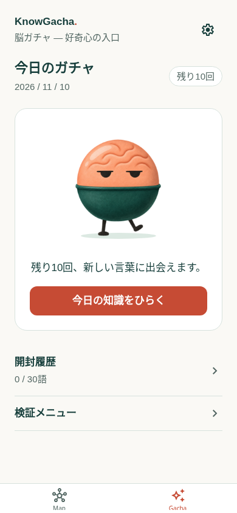

# 採用キャラクターでガチャを開く（2026-11-10）

## 実装前の設計

アイコン・起動画面に採用した脳のしわ・半目・短い足のカプセルを、アプリ内の待機表示と開封演出にも使う。ユーザーからアイコン反映の確認OKと、ガチャ演出にも同じキャラクターを使いたいとの要望があった。

### 画面と動き

- Gachaの待機時に同じキャラクターを表示し、文字の帯で顔を隠さない。GachaとMapからの開封は共通のCapsuleコンポーネントを使う。
- 保存成功後、短く左右に揺れ、脳のしわと半目のある上半分が上へ、足のある下半分が少し下へ分かれる。隙間から小さな光が現れ、消えて知識の結果へ進む。通常の開封は従来と同じ約900ms。
- 採用済みの画像をそのまま利用し、絵を描き直さずSVGの切り抜きでカプセルの曲面の継ぎ目に沿って分ける。小さな高密度画面でも十分な512pxの透過PNGへ書き出し、読み込み量を抑える。全体表示と上下の描画で同じ画像を共用する。
- 動きを減らす設定では演出を省いて結果へ進む。スキップ、背景移行、途中で画面やシートを閉じた場合に追加で抽選しない。完了通知は一度だけにし、表示を再利用した場合も次回の演出は最初から始める。
- 画像を読み込んでから演出し、画像エラーでは演出を省く。画像待ちは最大800msで切り上げ、結果表示を塞がない。狭い画面・暗い配色でもボタンと本文を操作できることを確認する。

### データ・配信

抽選・保存・権利の消費・結果表示のタイミング、履歴・Map・言語・通知設定の保存形式は変更しない。保存に失敗した場合は開封演出を開始しない。既存のAnimatedとreact-native-svgを使い、ネイティブ依存・アイコン・OS起動画面・runtimeVersionは変更しない。1.0.4向けの互換性のある更新として配信できる。

## 受け入れ条件

Gachaの待機／通常開封、Mapの開封、スキップ・閉じる・背面移行、連続開封、動きを減らす設定、画像の失敗・遅延を確認する。保存失敗・二重タップ・10回開封・履歴／残り回数の保持を回帰確認する。日本語／英語・320px幅・暗い配色、画像と曲面のつなぎ目を目視確認し、通常速度の動画でレビューできるようにする。lint・型チェック・自動テスト・iOS exportを実施し、iPhone実機の確認とは区別する。

## 実装・検証記録

- 同じ透過原稿から`assets/gacha-mascot.png`を512px・約183KBで書き出す。待機時は全体画像、開封時は曲面に沿う相補的なSVG切り抜きで上下を表示し、脳のしわ・半目・足を維持する。元の絵は変更しない。
- 単一のAnimated値で左右の揺れ・小さな上下動・上下の分離・光・フェードを動かす。移動と透明度はnative driverを使い、常時の待機アニメーションや毎フレームのReact再描画は追加しない。
- Gachaでは開封中の文言を画像の下へ移し、待機→開封でキャラクターの表示位置を維持する。画像の読み込み完了後に演出を始め、読み込み失敗・800msの画像待ち上限では保存済みの結果へ進む。
- 準備完了は通常のImageで判断し、SVG側の読み込み通知を待たない。インストール済みのreact-native-svgのAndroid実装ではビットマップがキャッシュ済みの経路でonLoadを送らないため、その通知を条件にすると開封が常に画像待ちで省略される可能性がある。共通画像を読み込み、前半の全体表示から後半の分割表示へつなぐ。
- 完了・背景移行・スキップ後のアンマウントで重複通知しないこと、表示の再利用時に姿勢を戻して次の開封を完了できることを、実際のeffectを使った単体テストで確認した。
- lint・型チェック・Nodeテスト12ファイル／66ケースが成功。iOS exportで新しいPNGを含むバンドルの生成も成功。version・runtimeVersion・依存・ネイティブ設定は1.0.4のまま。
- WebでGachaとMapの実際の描画をフレームごとに観測し、左右の揺れ・両半分の移動・光が表示されることを確認。保存後に演出が始まること、スキップ・タブ移動・シートを閉じる操作・英語の動きを減らす設定で、余分な開封が増えないことを確認した。
- 320×568の英語・ダークモードで表示とスクロール後の開封操作を確認。画像を失敗させた場合265ms、2.4秒遅延させた場合1470msでMapの保存済み結果へ進んだ（シート等の表示を含むWebの観測値）。
- 通常Gachaの10回開封、保存失敗時の回数保持、二重タップ、途中の再読み込み、当日分1回＋特典9回、履歴・読書・Mapへの導線と保存復元の既存テストも成功。
- 新しい開封演出のiPhone実機での見え方は未確認。1.0.4向けの互換更新として配信でき、アイコンを変える新ビルドは不要。

## プレビュー

待機から一回開封するまでのWeb録画。通常速度で、倍速にしていない。

## 参考

- [React Native 0.88 Animated](https://reactnative.dev/docs/0.88/animated)
- [Expo SDK 58 react-native-svg](https://docs.expo.dev/versions/v58.0.0/sdk/svg/)
