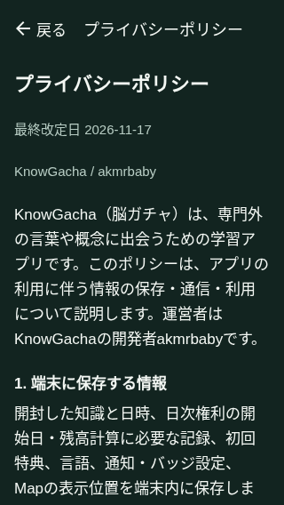
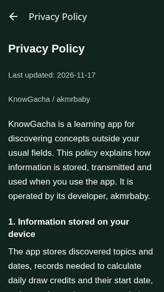
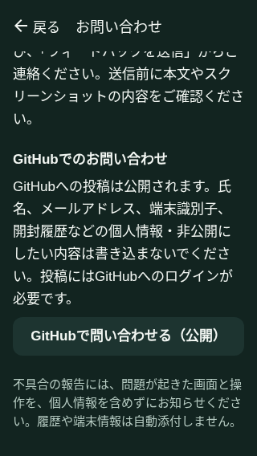
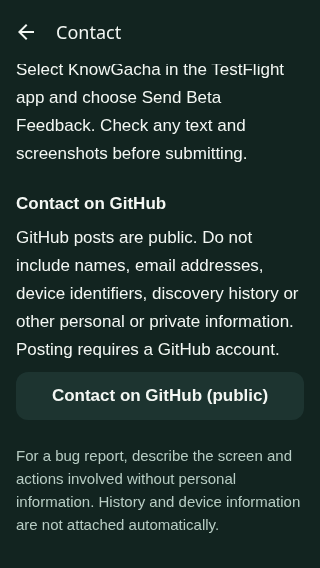

# プライバシーポリシーとお問い合わせ（2026-11-17）

状態: 実装・自動テスト・Web操作確認・iOS export済み。公開URLはdevelopへのマージ後に有効。実機での外部ブラウザ/フィードバック操作は未確認。

## 目的と範囲

TestFlight/App Store準備として、設定から日英のプライバシーポリシーとお問い合わせを開けるようにする。独自の利用規約を新設せず、App StoreではApple標準EULAを利用する方針。ポリシーはアプリに同梱してオフラインでも閲覧可能にし、同じ原稿を公開リポジトリのMarkdownへ書き出す。

公開メールや非公開フォームは未提供。存在しない窓口を作らず、現在利用可能なGitHub Issuesへ明示的な操作で案内する。投稿は公開されると事前表示し、氏名・メール・端末識別子・履歴等を投稿しないよう案内する。TestFlight参加者にはTestFlightのフィードバック送信手順も表示する。メール等が指定された場合に差し替えられるよう窓口を共通設定にする。App Store ConnectのFeedback Emailは別途ユーザー指定が必要で、架空のメールを設定しない。

## 確認したデータ処理

- AsyncStorage: v3進捗（開封語・日時・日次権利の開始日・特典・検証日付）、言語、リマインダー設定、バッジ設定、Map位置。サーバーへの履歴同期やユーザー登録はない。OSバックアップが有効な場合に保存領域がバックアップ対象となる可能性を否定しない。
- 通知・バッジは端末で予約するローカル通知。Pushトークンを取得する処理、Expo Push Serviceへ履歴を送信する処理はない。OS側で許可/停止できる。
- EAS Update: app.jsonのu.expo.devに対する更新確認・画像/JS取得。SDK 58インストール済みiOS実装はEAS-Client-ID、runtimeVersion/platform、更新ID・失敗更新ID、起動エラー情報を送信し得る。OSの通信先にはIP等の接続情報も伝わる。匿名である、個人を識別できない、通信情報を一切収集しないとは記載しない。
- 外部の参考資料、GitHub上の公開文書/Issues、Expoのポリシー、Appleの利用許諾は利用者の操作で外部サイトへ。各運営者の方針が適用される。GitHubの公開ポリシーをホストするサービスについてもGitHub Privacy Statementを参照できるようにする。
- 任意の問い合わせ・TestFlightによるフィードバックは、利用者が送信した内容をサポート対応・不具合修正に利用する。開封履歴や識別子を自動添付しない。TestFlightの診断・フィードバックはAppleの仕組みによる。
- 現行コードに広告、アカウント、独自の行動分析/広告SDK、課金、位置情報取得はない。通信を行うSDKを含むため、App Privacyの「データを収集しない」を本実装だけで確定しない。SDKと第三者の取扱い、App Store Connectの申告は提出時に別途確認する。

## 内容・UI

設定のサポート欄に「プライバシーポリシー」「お問い合わせ」「Apple標準利用許諾契約」を配置する。ポリシーには運営者（公開ハンドルakmrbaby）、改定日、データ/目的、提供先、保存・削除とバックアップ、通知許可、外部リンク、問い合わせ、改定を記載する。

本文は言語設定に従い、アプリ表示と公開文書は一つの日英原稿から生成する。公開URLは `https://github.com/akmrbaby/know-gacha/blob/develop/legal/privacy-ja.md` と `privacy-en.md`。リポジトリはPUBLIC、ログイン不要。実際に公開URLが存在するのはdevelopへマージ後であることを区別する。新しいWebホスティングや公開メールは作成しない。

既存の保存データやOS通知許可を変更しない。追加の同意チェック・利用状況計測・送信機能は導入しない。メール/ブラウザ等を開けない場合はエラーを表示し、閲覧中の原稿は保持する。

## 検証

日英・小画面・暗色で設定→ポリシー/問い合わせ→戻る、本文末尾、オフライン閲覧、外部リンク失敗表示、リンク先・自動送信/自動添付なし、保存済みデータ不変を確認。公開文書の再生成で差分が出ないことと、両言語の項目・参照先の一致を確認する。lint・型チェック・ロジックテスト・Web・iOS exportを行う。OSでの外部ブラウザ操作とTestFlightの実際のフィードバックは実機未検証として残す。

## 参考

- Apple App Review Guidelines 5.1.1 / App Store Connectの標準EULAの説明（2026-11-16に公式ページを確認）
- Expo SDK 58 Linking / Expo Router / Updatesの公式リファレンス
- `node_modules/expo-updates/ios/EXUpdates/AppLoader/FileDownloader.swift` のリクエストヘッダー処理と`expo-eas-client`の識別子実装

## 実装・検証記録

- `src/legal/policy.json`を日英の唯一のポリシー原稿とし、アプリ内の全文表示と`legal/privacy-ja.md`/`privacy-en.md`へ使用。サポート文書も`legal/README.md`に用意した。公開用の別ホスティングやメールアドレスは作成していない。
- 設定にポリシー・お問い合わせ・Apple標準EULAの導線を追加。ルートから記事・Mapへ戻る既存ナビゲーションや保存データは変更しない。
- `ExternalAction`は明示タップ時だけ外部リンクを開き、APIが拒否した場合は原稿を保持してエラーとコピーできるURLを表示する。SDK 58のexpo-linkingはWebでは同じタブへ移動するため、React Native 0.88のLinkingを使用し、Webでも閲覧中の画面を保つ。外部サイトへの自動投稿や情報の自動添付は行わない。
- lint・型チェック成功。Nodeテスト86ケースが成功し、公開原稿と同梱原稿の完全一致、日英の項目・参照先の一致、HTTPSリンクと自動添付なしを追加検証した。iOS Hermes exportに成功した。
- Webの日本語/英語、320×568、暗色で設定→全文→戻る→お問い合わせ、本文末尾への到達、外部リンクの引数と拒否/再試行時の表示、Apple EULA、保存レコード不変を確認。外部リンクはブラウザ側で記録し、実際の投稿は行っていない。
- Webでは一度開いた画面をキャッシュした状態で通信を切り、ポリシーを再表示して末尾まで読めた。初回オフラインでのネイティブ起動は実機未確認。iOSではJSONをアプリバンドルへ同梱し、本文取得のネットワーク要求は実装していない。
- データ処理とApp Store Connectの未確定事項は[privacy-data-audit.md](privacy-data-audit.md)に記録。専用の非公開窓口は未提供、TestFlight提出時のFeedback Email等はユーザー指定が必要。
- 新しいネイティブ依存・設定・runtimeVersion変更はなく、1.0.4への互換更新。マージ・配信、App Store Connectの設定は未実施。

### Webプレビュー

