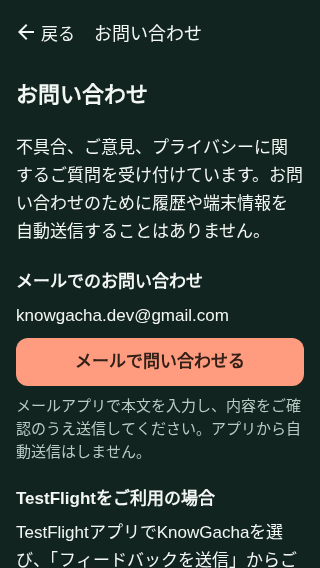
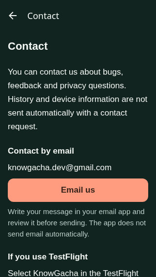

# 公開問い合わせメール（2026-11-17）

状態: 実装・自動テスト・Web操作確認・iOS export済み。実機のメール作成画面は未確認。

ユーザーが公開用メール`knowgacha.dev@gmail.com`を指定。アプリの「お問い合わせ」の最初にアドレスと「メールで問い合わせる」を追加し、タップで`mailto:`を開く。本文・添付・端末情報・履歴を自動で追加せず、送信は利用者がメールアプリで行う。メールアプリを開けない場合もアドレスをコピーできるようにする。既存のGitHub（公開）とTestFlightの案内は補助窓口として残す。

日英のプライバシーポリシー、公開サポート文書へ同じアドレスを記載する。メールによる問い合わせで受け取る送信元アドレス・本文・任意の添付の利用目的と保管・削除の方針を説明する。受信先はGmailなのでGoogleのプライバシーポリシーも参照する。ポリシーの公開版は同じ原稿から再生成する。

App Store ConnectのFeedback Emailへ使う値もこのアドレスに確定するが、外部サービスへの設定変更やメールの送受信は今回行わない。既存の保存データ・通知許可・取得権利・ネイティブ設定は変更しない。

検証: 送信先一致、本文/履歴/識別子の自動添付なし、メールリンクの失敗とコピー可能なアドレス表示、日英・小画面、原稿の一致を確認。lint・型チェック・既存テスト・Web・iOS exportを実施。メールアプリでの実際の作成画面は実機確認待ちとし、テストメールは送らない。

## 実装・検証記録

- `src/legal/policy.json`に公開メールと宛先のみのmailtoリンクを設定し、アプリ、日英ポリシー、公開サポート文書へ反映した。
- お問い合わせ画面の最初に選択・コピーできるアドレスと主操作「メールで問い合わせる」を配置。起動に失敗した場合はメール専用のエラーとアドレスを表示し、ブラウザで開くような不適切な案内にしない。
- ポリシーには、任意に送信される送信元アドレス・本文・添付、対応目的、保管/削除の方針、Gmailの利用とGoogleのポリシーを追加。公開原稿と同梱原稿の一致確認に成功した。
- lint・型チェック・Nodeテスト87ケースが成功。Webの日英/暗色320×568で、mailto宛先がユーザー指定と一致し、本文/履歴/識別子を含まないこと、メールアプリ起動APIの拒否と再試行、コピー用のアドレス、既存のGitHub/Apple EULA導線、保存データ不変を確認した。ブラウザ側で外部呼出しを記録し、メールの送信や受信確認は行っていない。
- iOS Hermes export成功。新しいネイティブ依存・runtimeVersion変更はなく1.0.4の互換更新。OSのメールアプリで宛先を確認する実機検証は未実施。
- App Store ConnectのFeedback Email等に使う値は確定したが、外部サービス自体への設定は未実施。マージ・配信は未実施。

### Webプレビュー

