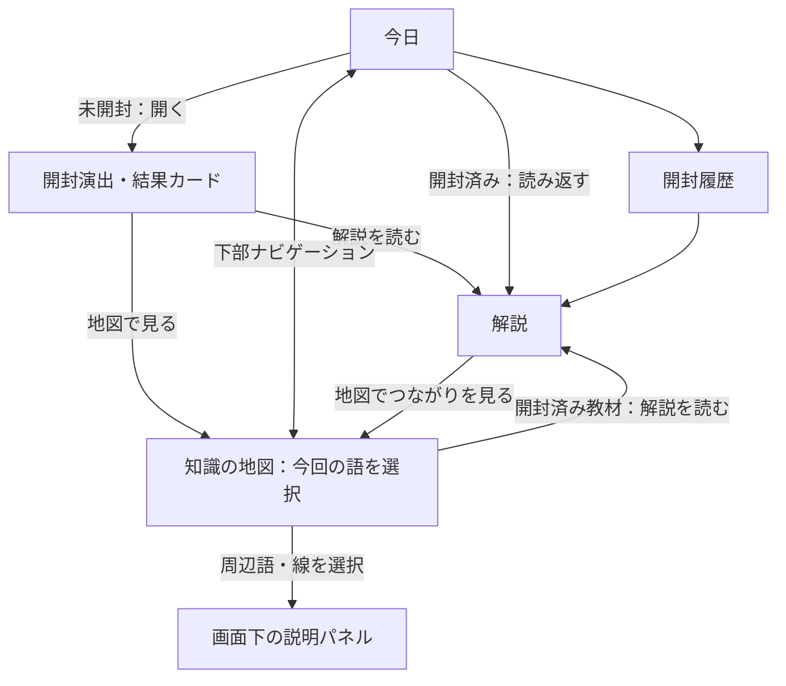

# KnowGacha UX設計 v0.2 — 開封と知識の地図

> 実機フィードバックを受けた次の方針は [v0.3](ux-design-v0.3.md) を参照。本書は最初のUI/UX試作の記録として保持する。

- 状態：UI/UX試作を実装。iPhoneでの新機能の実機検証は未実施。時間・寸法・配色は検証で調整する初期値。
- 作成日：2026-11-07
- 前提：`proposal.md` の全体構想と、Expo Goで動く3語の試作品。
- 今回の合意：教材原稿の完成度向上より、開封演出・読書・知識グラフを通したUI/UXの検証を優先する。
- 実行環境：Windows + WSL2 Ubuntu / Expo SDK 58 / React Native / TypeScript / iPhoneのExpo Go。

## 1. 目指す体験

**ガチャを開く → 言葉と出会う → 解説を読む → 知識の地図に加わったことが分かる。**

「開きたい」「知るのが楽しい」「出会った言葉が増えた」が伝わる体験を作る。地図は再閲覧と周辺概念への入口になる。開封数や地図の大きさを理解度とは扱わない。

テーマは「好奇心の標本箱」。温かい紙、深い緑、朱色の小さな印、整理されたラベルを使う。ホームの抽選物は紙の帯を巻いた小さなカプセル、結果は収集カードとして表現する。宇宙・レア度・大量の光や紙吹雪は使わない。

## 2. 今回の範囲

| 実装する | 今回は含めない |
| --- | --- |
| カプセル開封、結果カード、任意の短い振動 | 課金、有料抽選、通知、音声・効果音 |
| ホーム・解説・地図の一貫した見た目 | 高度な推薦、バックエンド、同期 |
| 3教材＋各教材2語の周辺語、説明付きの関係線 | 教材数の大幅拡充、原稿の全面改稿 |
| 地図の選択・移動・拡縮、一覧での代替操作 | 自動物理配置、ノードの自由編集、3D |
| 日次開封・保存・復元の既存仕様維持 | お気に入り、メモ、読了・習熟度の判定 |

周辺語の短い説明と関係説明は、地図の意味を検証するのに必要な分だけ用意する。こちらも試作用原稿と明記する。

## 3. 画面構成と移動

下部の主ナビゲーションは「今日」「知識の地図」の2つ。履歴は「今日」から引き続き開け、地図には一覧表示を用意する。解説は両方から開く共通の詳細画面とし、戻ると元画面・選択状態を保つ。

解説から地図へ移る際に同じ画面を何枚も積まない。解説を開いた出発点へ戻れるようにルートと履歴を設計する。演出画面は完了後に戻る操作で再抽選・再生されない。

## 4. ホームと開封の仕様

ホームには名称、短いタグライン、日付、中央のカプセル、「今日の一語を開く」、開封数、履歴への入口を配置する。開封前には語名を見せない。タップ位置は明確なボタンとし、複雑なスワイプや回転操作は要求しない。

### 開封の流れ

| 状態 | 表示と操作 | 目安 |
| --- | --- | --- |
| 未開封 | カプセルと開封ボタン。常時揺れる演出は付けない | 待機 |
| 保存中 | 未開封語を選出し日付と一体保存。連打を防止。長引く場合は保存中の説明 | 保存時間による |
| 期待 | カプセルを小さく傾け、紙の帯がほどける | 約250ms |
| 開く | 上下が離れ、中央からカードが現れる | 約350ms |
| 出会い | カードが定位置へ収まり、語名・分野・導入文を表示 | 約250ms |
| 結果 | 「解説を読む」を主操作、「地図で見る」を副操作として表示 | 自動遷移せず待機 |

保存が完了してから約0.9秒の演出を始める。保存前に成功を示す振動や語名を出さない。「演出をスキップ」を演出開始から使用可能にし、同じ結果カードへ直行できる。

結果カードに安定した概念ID、分野ラベル、控えめな図形印を対応させ、解説と地図でも同じ色・印を引き継ぐ。カードの印は知識の価値やレア度を示さない。

### 中断と再訪

- 保存失敗：演出を始めず、再試行を表示する。保存済みの進捗は更新しない。
- 保存成功後の中断・アプリ終了：開封自体は成立。同日に再起動したら同じ語を表示し、再抽選しない。
- 演出中のバックグラウンド移行：復帰時は結果カードへ進める。振動を遅れて再生しない。
- 同日の再訪：結果カードと「今日の一語を読み返す」。通常は演出を繰り返さない。
- 日付変更：抽選・保存時の現地日付で成立させ、表示途中で別の語に切り替えない。ホームに戻った時点で新しい日を反映する。
- 全件開封：当日は最後の結果を表示。翌日以降は「三つの扉が、開きました」と地図・履歴への入口を表示。

振動は開く瞬間の軽い1回のみを候補とする。振動を使えない端末でも成立させ、失敗で開封を止めない。

## 5. 読む画面

上部に結果と同じ印・分野・語名・導入文。その下に「まずは、ひとくち。」の短い解説、深掘りの各節を続ける。地図は読書を遮る全画面演出として挿入しない。

短い解説の後に「この言葉のまわり」を配置し、関連語2件と関係ラベルを表示する。選ぶとその関係を選択した地図へ移動する。本文の最後にも「地図でつながりを見る」を配置する。最後までスクロールしたことを理解・読了とは記録しない。

開封結果と解説のつながりは、同じカードの意匠と短いフェードで表現する。実際に画面をまたいで同じ要素を変形させる複雑な遷移は、この段階では必須にしない。

本文は原則17px相当以上、行間は約1.7〜1.8倍、左右余白は20〜24pxを初期値とする。文字拡大を許可し、長い日本語名を省略しない。

## 6. 知識の地図

### 表示範囲

初期の地図データは3つの主教材と各2語の周辺語、計9ノード・6本の関係線。未開封の主教材とその周辺は、名前の事前公開を避けるため地図上に表示しない。開封済み教材とその周辺だけを表示する。

初回開封前は空の地図に「最初の一語を開くと、ここに小さな地図が生まれます」とホームへのボタンを表示。最初から9個の空欄や未獲得枠を埋める画面にはしない。

各教材は別の小さなまとまりとして固定配置する。画面上の距離は読みやすさのための配置であり、概念間の厳密な近さではない。関係のないまとまりを線でつながない。

### ノード・線の表現

| 要素 | 表現 | 選択時 |
| --- | --- | --- |
| 開封済み教材 | 塗りのある角丸カード、分野名、語名、図形印 | 導入文と「解説を読む」 |
| 周辺語 | 紙色の輪郭カード、「周辺語」ラベル、語名 | 短い説明と元教材との関係 |
| 関係線 | 方向が分かる矢印、短い関係ラベル | 元・先・関係の種類と説明 |
| 選択中 | 太い輪郭と「選択中」の表示 | 対応する説明パネルを更新 |

色だけで状態を区別しない。周辺語は開封済み教材の数に含めず、ロック記号を付けない。日次制限なしで短い説明を何度でも読める。次回試作では周辺語の全文教材は用意しない。

### 操作

- 初回の地図表示は直近に開封した教材のまとまりへ寄せる。
- 結果画面から入った場合、その教材と2本の線を約600msの短いフェードで表示。強制カメラ移動は初期位置決定の1回に限る。
- ノードを押すと画面下に説明パネルを表示。線やラベルを押すと関係の説明を表示。
- 背景をドラッグして移動。ピンチと「＋」「−」で拡縮。「全体」「選択に戻る」で位置を復元する。
- 拡縮は例として0.75〜1.5倍に制限し、小さくしすぎて読めなくならないようにする。
- 視覚上細い線にも幅24px相当以上の選択領域を設ける。重なる場合はノードを優先。パネル内の関係一覧からも同じ説明へ到達できる。
- パネルは常に画面内に固定し、地図と一緒に拡縮しない。長文はパネル内でスクロール。選択解除と「解説を読む」は別の操作にする。
- 地図上部の「地図／一覧」で同じ教材・周辺語・関係を一覧表示できる。読み上げ利用時もこちらから全情報へ到達できる。

### 関係の候補

以下は構造検証用の候補。実装時に短い説明と根拠となる参照先を用意する。関係が成立する範囲を説明に含める。

| 主教材 | 周辺語 | 関係の向き・ラベル |
| --- | --- | --- |
| 光電融合 | 光通信 | 光電融合 → 光通信：利用する技術 |
| 光電融合 | シリコンフォトニクス | 光電融合 → シリコンフォトニクス：実現を支える技術の一つ |
| エスノグラフィー | 参与観察 | エスノグラフィー → 参与観察：主要な調査方法の一つ |
| エスノグラフィー | フィールドノート | エスノグラフィー → フィールドノート：調査を記録する手段 |
| シュルレアリスム | 自動記述 | シュルレアリスム → 自動記述：表現の方法の一つ |
| シュルレアリスム | アンドレ・ブルトン | アンドレ・ブルトン → シュルレアリスム：運動を主導した人物の一人 |

## 7. データと保存

教材・周辺語・関係・配置・ユーザー進捗を分離する。今回の体験は、既存の開封データから表示可能範囲を導出できるため、進捗スキーマv1を維持する。

| データ | 主な項目 | 保存場所・扱い |
| --- | --- | --- |
| 主教材 | 既存ID、名称、本文、分野ID、図形印ID | 同梱マスター。既存IDを維持 |
| 周辺語 | ID、名称、短い説明、分野ID、参照先ID | 別の同梱マスター。日次抽選には入れない |
| 関係 | ID、sourceId、targetId、種類、ラベル、説明、参照先ID | 同梱マスター。全端点IDの存在を検証 |
| 配置 | 版、概念ID、固定座標 | 同梱マスター。画面幅に合わせた初期表示変換 |
| 開封記録 | 既存のkeywordId、date、openedAt、dayOffset | 現行AsyncStorageのキーとスキーマを維持 |
| 選択・移動・拡縮・表示モード | 選択ID、表示変換など | 画面表示中の状態。再起動時は直近教材へ戻る |
| 演出状態 | 保存中／期待／開く／結果など | 一時状態。保存しない |

グラフの解放状態・表示ノード数を別途保存しない。開封成功時点で地図にも追加済みとし、実際に地図を訪れなくても同じ状態になる。周辺語閲覧で開封数が増えない。

今後保存項目を増やす場合は、旧データを保持する移行を設計書に記載してから実装する。UI変更を理由に既存進捗を初期化しない。

## 8. 技術方針

画面は引き続きExpo Routerの `src/app/`、演出・地図・データ処理はその外に置く。ホームと地図を主ナビゲーションにまとめ、既存の履歴・詳細URLとの互換性を考慮してルートを移行する。

演出は位置・回転・不透明度の変化を中心にし、重い画像素材や毎フレームのReact状態更新を避ける。地図は最大9ノードの固定配置とし、レイアウト計算をアニメーション中に繰り返さない。日本語ラベルは小画面と文字拡大で読めるよう改行する。

想定候補は、既存のReact Native標準アニメーション、Expoの振動モジュール、SVG描画、ジェスチャー処理。採用結果は末尾の実装記録を参照。SDK 58の公式資料でAPI・Expo Go対応を確認し、追加依存はexpo-hapticsに限定した。デザインのための画像生成、独自ネイティブコード、物理演算ライブラリは現時点では不要。

OSの動きを減らす設定に対応し、カプセルの回転・移動と地図の追加演出を省略して最終状態を表示する。演出途中の設定変更でも結果へ進める。選択領域は主要操作44px相当以上。長い語名や文字拡大で操作ボタンが画面外へ消えないようにする。

## 9. 実装の順序

1. **画面の骨格とデータ**：カード・ラベルの共通化、主ナビゲーション、周辺語・関係・配置の分離、既存進捗の維持。
2. **開封の体験**：保存後の演出・スキップ・結果カード・解説への遷移、中断復帰と動きを減らす設定への対応。
3. **小さな地図**：表示範囲の導出、固定配置、選択パネル、線の説明、一覧、移動・拡縮と位置のリセット。
4. **体験をつなぐ**：解説から関係を選んで地図へ移動、結果から直近教材へ寄せる、戻る操作と表示状態の調整。
5. **実機で調整**：iPhoneで文字サイズ・演出時間・片手操作・読み上げ・ジェスチャーを確認し、設計書に結果を残す。

各段階でlint・型チェックを行う。選出・保存の既存テストを維持し、地図の表示範囲・参照整合性など挙動のある部分を検証する。featureブランチからdevelopへPRを作成する。

## 10. 受け入れ条件

- 初回に「何を押すと開くか」が分かり、約1秒の演出から結果へ進める。スキップしても同じ語になる。
- 連打・再起動・演出中の終了で重複開封せず、同日の語が変わらない。保存失敗で成功演出を出さない。
- 結果・解説・地図で同じ語を見ていることが分かり、操作前に自動で別画面へ飛ばない。
- 開封1語なら主教材1・周辺語2・関係線2、全件開封なら9ノード・6本の関係線が見える。
- 周辺語と開封済み教材を見分けられ、周辺語を読んでも開封数は増えない。
- すべての線について「何と何が、どう関係するか」を文章で読める。一覧でも同じ情報に到達できる。
- パン・拡縮で迷っても「全体」「選択に戻る」で復帰できる。ノード操作と背景ドラッグが誤判定されにくい。
- 文字拡大、読み上げ、動きを減らす設定でも、開封・読書・地図の情報に到達できる。
- 既存端末の開封履歴がそのまま使え、開発用の翌日扱い・初期化が地図にも反映される。

## 11. 実機検証記録

未実施。実装後、端末・日付・確認範囲・気づき・変更した初期値をここに追記する。

判断したいこと：開封をもう一度体験したいか、結果から自然に読み始められるか、地図を見て増えたことが伝わるか、関係の説明を読みたくなるか。操作を誤った箇所・読みにくい箇所も記録する。

## 12. 変更履歴

- 2026-11-07：UI/UXを次の検証対象として初版作成。標本箱の意匠、短い開封、3つの小さな地図、既存進捗の維持を設計。

## 13. UI/UX試作の実装記録

- 主ナビゲーションはExpo RouterのJavaScript Tabs。「今日」「知識の地図」を配置し、履歴・教材の詳細URLを維持。
- カプセルはReact NativeのAnimatedで回転・上下分離・フェードを表現。保存後に900msで結果カードへ進み、スキップ・バックグラウンド移行・動きを減らす設定でも同じ結果へ到達する。
- 振動にはExpo Go対応の `expo-haptics` を採用。開封演出開始から250ms後に軽い振動を1回。失敗を握りつぶして進行を妨げない。効果音は追加しない。
- 地図は標準のView・Pressable・PanResponderで描画・操作。9ノードの固定配置のためSVGやジェスチャー用の追加依存は採用しなかった。線の選択領域は28px相当、ラベルや一覧からも説明へ到達可能。
- 地図の説明パネルは下部に固定してスクロール可能にした。小画面では地図・操作部分も独立してスクロールし、パネルを地図と一緒に拡縮しない。
- 通常の拡縮は0.75〜1.5倍。「全体」のみ全クラスタが画面幅に収まる倍率に下げ、周辺語ラベルを簡略化する。選択すると通常倍率へ戻す。全体表示では縦方向の間隔を維持して重なりを抑える。
- カードと解説の連続性は共通の印・色・導入文で表現。画面をまたいだ共有要素の変形は採用せず、画面遷移は標準ナビゲーションに任せた。
- 主教材・周辺語・関係・固定配置は `src/data/graph.ts` に集約し、本文マスターとは分離。進捗スキーマと保存キーはv1のまま。地図表示は開封記録から導出し、演出や地図の選択状態は永続化しない。
- 周辺語に参考資料のURLを持たせ、関係説明からも同じ資料を開ける。短い説明は試作用。公開用の校閲は未実施。
- Reactのlintで、PanResponderへ渡す遅延実行コールバックがrefの描画中アクセスと判定されるため、その生成箇所の1行だけ例外とした。実際のrefアクセスはジェスチャーイベント内に限定。

### 実機で追加確認する項目

1. 既存の履歴が残り、同日の開封が増えないこと。
2. 開発用の翌日扱いで未開封語を開き、約1秒の演出・振動・スキップを確認。
3. 演出中にホーム画面へ出て復帰する場合と、アプリを終了して開き直す場合に同じ語が出ること。
4. 解説の「この言葉のまわり」から地図へ進み、対応する関係の説明が選択されること。
5. 地図の線・ノードの選択、背景ドラッグ、ピンチ、＋／−、全体、選択に戻るを確認。
6. 一覧から教材・周辺語・関係をすべて読めること。解説から戻ると地図の選択が維持されること。
7. 3語開封後の9ノード・6関係、初期化後の空の地図を確認。
8. iPhoneの文字拡大・VoiceOver・動きを減らす設定で、情報と主操作に到達できること。

自動チェックおよびブラウザ上の確認結果は以下に記録する。

### 自動チェック・ブラウザ確認の結果

- lint・TypeScript型チェック：成功。
- ロジックテスト6件：既存の日次開封・復元4件に加え、開封に応じた地図の表示範囲、関係端点・配置の整合性を検証。
- iOS/Web向けのExpo export：成功。
- Chromiumの390×844表示で、未開封→結果→解説→地図→周辺語の閲覧、再読み込み後の同日復元、全件開封時の一覧6周辺語を確認。ページの実行時エラーなし。
- スマートフォン幅のスクリーンショットを確認し、ホームの余白を減らして開封ボタンを初期表示内に収めた。地図は高さ260px、初期倍率0.75倍とし、ノードと操作ボタンをまとめて表示。説明パネルは画面の最大34%で独立スクロールする。
- 以下はブラウザ上の参考画像であり、iPhoneのスクリーンショットではない。iPhoneでの振動・ピンチ・VoiceOver・動きを減らす設定は未検証。

| ホーム | 開封結果 | 地図 | 全体表示 |
| --- | --- | --- | --- |
| [画像](previews/home.png) | [画像](previews/reveal.png) | [画像](previews/map.png) | [画像](previews/overview.png) |
