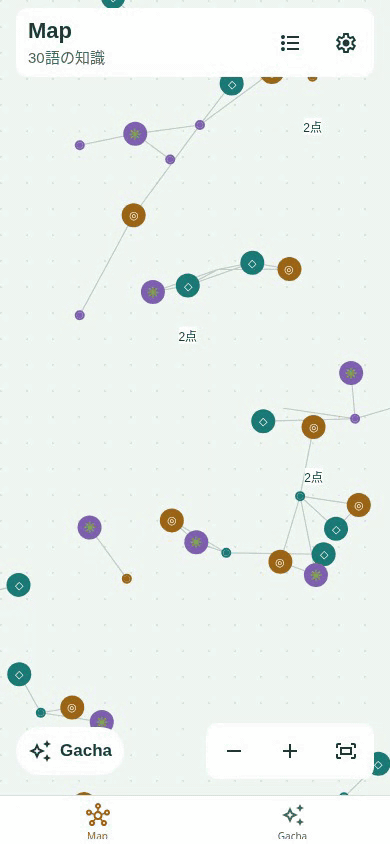

# 眺めて動きが分かるMapへの調整（2026-11-10）

## 実装前の設計

iOS実機で動きが分からないという報告が続き、1〜2点/秒の小さな動きと、縮小・選択による広い停止範囲を見直す。丸いノードと名前・線が動くことを、通常のMap画面を眺めるだけで認識できるようにする。#37の起動状態同期修正を含む最新developを土台とし、今回の変更で実機の原因が判明したとは扱わない。

- 通常倍率では毎秒約4〜7点、元の位置から28〜42点を上限とする個体差。方向は滑らかに変え、目的地に着く前に次へ向かうことで長い停止を減らす。個体の休止は短くする。
- 倍率0.35での一律停止を撤去。縮小時も画面上で見える速度と範囲へ調整し、俯瞰では範囲を小さくする。ズームの最中は移動量を変えず、離した後に速度と行き先を調整して、指を離した位置を跳ねさせない。
- プレビューで選んだノードだけを止め、周辺ノードは動かす。関係を選んだ場合は両端を止める。詳細シート・操作中・非表示・背面では全体を止める。OSの動きを減らす設定は維持し、設定画面で停止理由を表示する。
- 移動によって縮小時の集約数や代表ノードが頻繁に変わらないよう、表示範囲・集約は基準座標から計算する。線・ラベル・当たり判定・フォーカスは従来どおり動いた描画座標に揃える。

## データと範囲

取得履歴・権利・知識ID・カメラ・保存形式・ネイティブ依存は変更しない。約30Hz・表示中のノードのみ更新・3パス描画を保持する。新規の常時D3計算やReactの毎フレーム再描画は追加しない。

## 受け入れ条件

通常倍率と縮小した30件のMapで、数秒間の観測で位置変化が分かること。初回開封後の選択プレビューでも周辺が動くこと。ズーム中・選択対象・詳細表示・OS設定での静止、再開とドラッグ／ピンチ解放時の連続性、集約・線の追従、カメラと進捗の不変を確認する。単体・Webの比較と動画、lint・型チェック・iOS exportを実施し、iPhone実機での解消は別途確認する。

## 実装

- 画面上の速度・移動範囲を倍率から求める。通常倍率の最大速度は約4〜7点/秒、最大範囲は28〜42点。俯瞰では速度を通常の約65〜100%、範囲を8点から通常範囲までに抑える。目的地は4〜8秒で更新し、まれに0.8〜1.8秒休む。速度と方向は補間する。
- 操作後は0.8秒待ち、0.6秒かけて再開。ズーム倍率が変わっても移動量のワールド座標を保持し、新しい範囲へ徐々に戻す。倍率の変更で描画座標を掛け直して跳ねさせない。
- 選択した点だけを止め、隣接する点は動かす。関係を選んだ場合は両端を止める。詳細・非表示・背面・OS設定による停止は継続する。
- 表示範囲と集約は動きの基準座標で求め、浮遊による代表点・集約数の切り替わりを防ぐ。線・文字・タップは共通の描画座標を使う。
- 設定画面に「Mapの動き」を追加。通常の動作説明と、OSの「視差効果を減らす」による停止理由を日本語・英語で表示し、OS設定の変更にも追従する。

## 検証記録

- lint・型チェック・Nodeテスト10ファイルが成功。10分相当の範囲・速度・滑らかな方向転換、倍率0.05〜2.2での画面上の移動、倍率変更時の座標保持と新しい範囲への復帰、選択対象だけの停止と周辺の移動を検証した。
- 390×844のWebで30教材を取得した通常Mapを開き、ズーム・フォーカス操作なしで観測。初期倍率0.176、表示44点で、4秒間の移動距離は最大18.69px。複数の点が6px以上移動し、代表点・集約数・3パス描画・カメラ・進捗が変わらないことを確認した。
- 選択対象の静止と周辺の移動、線の追従、動く点のタップ、タッチ中の停止と解放後の再開、ドラッグ解放時の座標継続、OS設定の動的な切り替えをWebで確認。通常モーションで二本指ピンチを行い、指を離した後の余分な位置ずれがないことを確認した。
- 5/10/50/100/500件デモで描画上限と3パスを確認（500件の俯瞰は41点をマウント）。設定への出入り、日本語・英語の切り替えと復元、320×568・ダークモード・大きな文字でも言語選択を操作できること、カメラ・履歴・権利の保持を回帰確認した。
- iOS exportが成功。ネイティブ依存・設定・runtimeVersionを変更しないため、既存の1.0.2 Preview向け更新の範囲。
- iPhone実機での見え方と解消は未確認。動画・座標の測定値はWebの結果であり、ネイティブの動作・性能を保証する測定ではない。

## 通常速度のプレビュー

30教材を取得した通常Mapの10秒間。ズーム操作なし、倍速なし。

